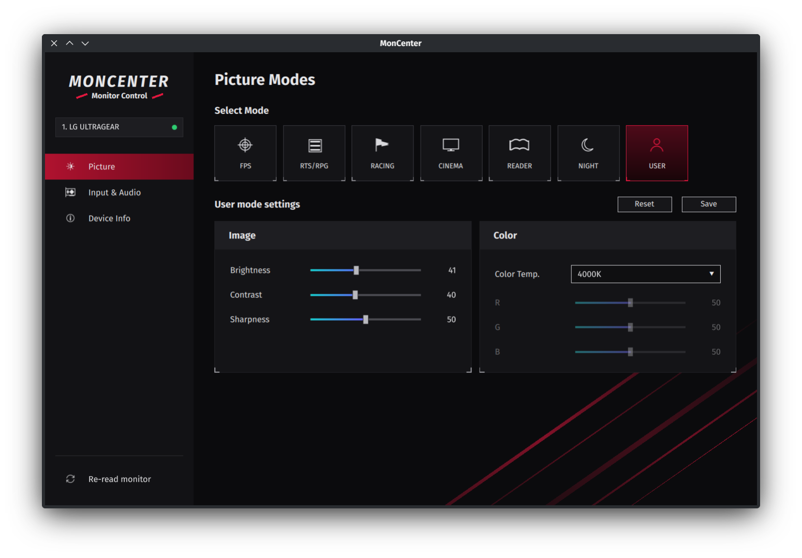

# MonCenter

Gaming-style control panel for external monitors on Linux. It talks DDC/CI through [ddcutil](https://www.ddcutil.com/), so you can change brightness, contrast, sharpness, color temperature, R/G/B gain, input source and speaker volume without the monitor's joystick.



- **Picture modes**: FPS, RTS/RPG, Racing, Cinema, Reader, Night, User. These are presets kept in the app, and you can save your own values into any of them.
- **Input & Audio**: switch inputs, change volume, mute.
- **Device Info**: serial, firmware, refresh rate, usage hours.

There's also a small KDE Plasma 6 panel widget in `package/` with the same controls.

## Requirements

- `ddcutil`, with your user able to open `/dev/i2c-*` (add yourself to the `i2c` group if needed)
- `pyside6`

```bash
yay -S ddcutil pyside6
```

## Run

```bash
./app/moncenter.py
```

Install a launcher and a start-menu entry:

```bash
ln -sf "$PWD/app/moncenter.py" ~/.local/bin/moncenter
sed "s|^Exec=.*|Exec=$HOME/.local/bin/moncenter|" app/moncenter.desktop > ~/.local/share/applications/moncenter.desktop
```

Install the panel widget:

```bash
kpackagetool6 -t Plasma/Applet -i package
```

## Notes

- Only the first display ddcutil detects is controlled.
- Codes are standard MCCS ones (tested on an LG UltraGear GS85Q). Vendor-only picture modes are not exposed.
- Switching to an input with nothing plugged in blanks the screen. Switch back with the monitor's own buttons.

## Disclaimer

MonCenter writes settings to your monitor's hardware over DDC/CI. Use it at your own risk. It comes with no warranty of any kind, and the authors aren't responsible for any damage, lost settings or other problems that come from using it. Monitors implement DDC/CI differently, so a value that works on one model can behave unexpectedly on another.

## License

[MIT](LICENSE)
